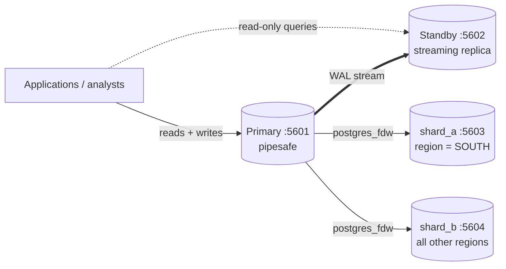

# Distributed and Cloud Database Design for PipeSafe

This portfolio takes the PipeSafe database from one server to several. It demonstrates **replication** (copies for availability and read capacity), **failover** (surviving the loss of the main server) and **sharding** (splitting data across servers by region). It measures the **consistency vs availability trade-offs** between them.

Everything below was run on a real multi-server PostgreSQL 18.6 cluster (Ubuntu 26.04 under WSL 2 on an Intel Core i7-6500U laptop). The outputs are in `results/`.

## 1. Why PipeSafe Needs More Than One Server

| Need | Why it matters for PipeSafe | Technique |
|---|---|---|
| **Stay available** | Operators must report accidents to the regulator promptly. The reporting system cannot be down because one server failed. | Replication + failover |
| **Never lose a committed report** | Accident reports are regulatory records | Synchronous replication |
| **Serve many readers** | Dashboards, analysts and auditors read far more than operators write (about 360 reports a year: 6,052 over 16¾ years) | Read replicas |
| **Grow, and keep data near its users** | Regional offices mostly query their own region | Sharding by region |

## 2. The Cluster



| Server | Port | Role |
|---|---|---|
| primary | 5601 | Accepts reads and writes. Also the **coordinator** for the sharded table. |
| standby | 5602 | Byte-for-byte copy of the primary, kept up to date by streaming the write-ahead log (WAL). Read-only. |
| shard_a | 5603 | Holds SOUTH-region accidents |
| shard_b | 5604 | Holds all other regions |

Each server is a separate PostgreSQL instance with its own data folder, port and processes. They are created by `scripts/setup_cluster.sh`. For the test they all ran on one machine. In production each would be on a different machine, ideally in a different data centre ("availability zone").

## 3. Replication (`scripts/replication_demo.py`, `results/replication_demo.log`)

### How it was set up

The standby was created with `pg_basebackup -R -X stream -C -S standby_slot`:
- `pg_basebackup` copies the primary's files.
- `-R` writes the connection settings for streaming.
- `-S standby_slot` creates a *replication slot*, so the primary keeps any WAL the standby has not received yet, even if the standby is offline for a while.

The test was deliberate: the standby was created while the primary was **empty**, and the whole Portfolio 1 database was loaded afterwards. Everything arrived on the standby through streaming alone.

### R1: Both servers hold identical data

```
primary  port 5601: in recovery (read-only replica) = False, accidents = 6052, total cost = 4619299360.00
standby  port 5602: in recovery (read-only replica) = True,  accidents = 6052, total cost = 4619299360.00
primary sees replica: application=walreceiver state=streaming sync_state=async
```

### R2: Asynchronous replication has a short, real delay

By default, a `COMMIT` on the primary returns **before** the standby has the change. 20 new reports were inserted, and the standby was read immediately after each commit:

| Measure | Result |
|---|---|
| Immediate read on the standby found the new report | **0 of 20** (every immediate read was stale) |
| Time until the report appeared on the standby | median **6.26 ms**, max 10.94 ms |

The delay is small here because all four servers share one machine. Across a real network it is larger, and it grows under heavy load. Any application reading from a replica must accept that it may be slightly behind: an operator who submits a report and immediately searches the replica might not find it yet.

### R3: The standby cannot be written to

```
INSERT on standby -> ERROR:  cannot execute INSERT in a read-only transaction
```
All writes must go to the primary. This rules out conflicting writes.

### R4: Synchronous replication removes stale reads, at a price

With `synchronous_standby_names = '*'` and `synchronous_commit = 'remote_apply'`, `COMMIT` waits until the standby has **applied** the change:

| | Asynchronous | Synchronous (`remote_apply`) |
|---|---|---|
| Median commit time per report | 8.72 ms | 10.90 ms (**1.3× slower**) |
| Stale immediate reads on the standby | 20 of 20 | **0 of 20** |

Every commit now pays for a round trip to the standby. Here that added about 2 ms; between data centres it could be several milliseconds per commit.

### R5: When the standby fails, choose consistency or availability

With synchronous replication on, the standby was stopped and a new report was inserted on the primary:

```
after 5 s the INSERT is still waiting: True
WARNING:  canceling wait for synchronous replication due to user request
DETAIL:  The transaction has already committed locally, but might not have been replicated to the standby.
```

**The primary would not complete the commit.** It refused to promise a write that existed on only one server, so the database was **unavailable for writes** while the standby was down. This is consistency chosen over availability.

Switching back to asynchronous replication (`ALTER SYSTEM RESET synchronous_standby_names`) made the next insert complete in **28.8 ms**, with the standby still down. Availability returned, but that report existed on one server only until the standby came back. When the standby was restarted, it caught up automatically using its replication slot within 198 ms, and both test reports were present.

### R6: Failover — the primary crashes

```
crash primary (immediate stop): server stopped
connect to primary -> connection to server on socket "/tmp/.s.PGSQL.5601" failed
write to standby before promotion -> ERROR:  cannot execute INSERT in a read-only transaction
promote standby: SELECT pg_promote() -> True
write on the NEW primary (port 5602) succeeded 0.76 s after the crash
new primary: in recovery = False, accidents = 6196, last pre-crash report present = True
```

| Recovery measure | Result |
|---|---|
| **RPO** (data lost) | **None.** The last report committed before the crash was on the new primary. |
| **RTO** (time to accept writes again) | **0.76 s** from crash to the first successful write, *after* the decision to promote |

The 0.76 s does not include *detecting* the failure, which was instant here because the script caused it. In production a tool such as Patroni, or a managed cloud service, watches the primary, waits a configured time to avoid false alarms, then promotes automatically. RPO is only zero if the standby had received everything. With asynchronous replication, the last few milliseconds of commits could be lost in a real crash (R2).

## 4. Consistency, Availability and the CAP Theorem

The **CAP theorem** says that when a network partition happens (servers cannot reach each other), a distributed system must choose between:
- **Consistency:** every read sees the latest write.
- **Availability:** every request gets a response.

The **PACELC** extension adds that **even without a partition**, there is a trade-off between **Latency** and **Consistency**.

The measurements show both:

| Situation | Choice | Evidence |
|---|---|---|
| Normal operation, asynchronous | Low latency, weaker consistency (replica may be stale) | R2: 20/20 immediate reads stale; 8.72 ms commits |
| Normal operation, synchronous | Strong consistency, higher latency | R4: 0/20 stale; 10.90 ms commits |
| Standby unreachable, synchronous | **CP**: consistent but unavailable for writes | R5: commit blocked |
| Standby unreachable, asynchronous | **AP**: available but writes are not yet replicated | R5: commit in 28.8 ms |

**PipeSafe's choice:**
- **Accident reports use synchronous replication.** They are legal records, so losing one is worse than a short delay. Writes are rare (about one a day on average), so the extra latency costs almost nothing.
- **Use two standbys with `synchronous_standby_names = 'ANY 1 (s1, s2)'`.** Commits wait for *either* standby, so losing one standby does not block writes. This avoids the R5 outage while keeping zero data loss.
- **Analysts' dashboards read from replicas.** A delay of a few milliseconds is irrelevant for trend reports, and it keeps heavy reporting queries off the primary.

## 5. Sharding by Region (`sql/01–03`, `results/03_sharding_queries.log`)

### Design

Sharding splits **rows** across servers. Each shard holds a subset; together they hold everything.

PipeSafe is sharded on **region**, using the U.S. Census region stored in the `state` table since Portfolio 1:
- **shard_a:** SOUTH
- **shard_b:** every other region (DEFAULT)

The coordinator (the primary) has one table, `dist.accident_by_region`. It is **partitioned by region**, and each partition is a **foreign table** stored on a shard server through `postgres_fdw`. Applications use one table name, and PostgreSQL routes each row and query.

### Results

**Distribution.** 6,052 accidents loaded through the coordinator:

| | shard_a (SOUTH) | shard_b (others) |
|---|---|---|
| Accidents | 3,682 | 2,370 (Midwest 1,198, West 814, Northeast 258, unknown 99, territory 1) |

The direct query on each shard server (`results/shard_nodes.log`) confirms each holds only its own regions. The total through the coordinator matches the unsharded database exactly: **6,052 accidents, $4,619,299,360**.

**A single-region query touches only one shard (partition pruning).** "Texas accidents in 2023" contains `region = 'SOUTH'`. The plan reads **only shard_a**, and the whole filter is sent to that server:
```
Foreign Scan on dist.accident_south
  Remote SQL: SELECT report_number, accident_datetime, unintentional_release_bbls
              FROM public.accident_shard WHERE (accident_datetime >= '2023-01-01') AND
              (accident_datetime < '2024-01-01') AND (region = 'SOUTH') AND (state_code = 'TX')
```
Result: 147 accidents, the same as Portfolio 2 Q3 on the unsharded database.

**A cross-region query asks every shard (scatter-gather).** "Cost by cause category" needs all regions. The coordinator queries **both shards in parallel** (`Async Foreign Scan`) and combines the results. By default each shard sends **all its rows**, and the coordinator does the grouping.

**Pushing the work to the shards.** When the grouping includes the shard key (`GROUP BY region, cause_category`) and `enable_partitionwise_aggregate` is on, each shard runs its own `GROUP BY` and returns only its totals:
```
Async Foreign Scan
  Relations: Aggregate on (dist.accident_south)
  Remote SQL: SELECT region, cause_category, count(*), sum(total_cost_usd)
              FROM public.accident_shard GROUP BY 1, 2
```
This sends a few dozen summary rows over the network instead of thousands of detail rows. In PostgreSQL 16 and 18 (both runs gave identical plans), this pushdown only happens when the grouping includes the partition key. That is a reason to choose a shard key that matches common reporting queries.

**Inserts are routed automatically.** A new Louisiana report inserted through the coordinator landed on shard_a (1 row) and not on shard_b (0 rows).

### Shard key trade-off: region vs hash

| Strategy | shard_a | shard_b | Strength | Weakness |
|---|---|---|---|---|
| **By region** (used) | 3,682 (61%) | 2,370 (39%) | Regional queries hit one shard; data can live near its region | **Uneven ("hot") shard**: Texas alone is 41% of all accidents |
| **By hash of report_number** | 3,029 (50%) | 3,023 (50%) | Almost perfectly even | *Every* regional query must ask every shard |

The region choice is deliberate: most PipeSafe queries are regional, and pruning saves more work than the imbalance costs. If the South kept growing, it could be split further (e.g. Texas on its own shard) without changing the design.

### Costs and limits of sharding

- **No global uniqueness.** A primary key is enforced **within each shard only**. PostgreSQL cannot stop the same report number from being inserted into two shards. PipeSafe relies on PHMSA's unique report numbers and on routing by region.
- **Cross-shard transactions.** A transaction updating rows on both shards is not fully atomic across servers without two-phase commit.
- **Moving data.** Changing the shard key or adding shards means moving rows between servers ("resharding").
- **More to operate.** Each shard also needs its own replica for availability, so 2 shards with 1 standby each means 4 servers, plus the coordinator.

**Is sharding needed at PipeSafe's current size?** No. 6,052 accidents (20 MB) fit easily on one server, and Portfolio 2 showed that even 100× the data is handled by indexes and materialised views. Replication is needed now for availability. Sharding is the plan for growth, for example if PipeSafe added pipeline sensor data (see Portfolio 4) or reports from other countries.

## 6. Moving to the Cloud

| Concern | On-premise (this demo) | Managed cloud service |
|---|---|---|
| Standby and failover | `pg_basebackup`, `pg_promote()` by hand (R6) | Built-in "high availability" option; the provider detects failure and promotes automatically |
| Read replicas | Created and monitored manually | Created with a few clicks; replica lag shown on a dashboard |
| Backups | Must be scripted | Automatic, with point-in-time recovery |
| Placement | One machine | Separate availability zones, or regions closer to users |
| Sharding | `postgres_fdw` set up by hand | Distributed PostgreSQL services, or MongoDB Atlas sharded clusters |

**MongoDB Atlas (Portfolio 4) is already distributed.** Every Atlas cluster, including the free tier, is a **3-node replica set**. `scripts/atlas_replica_check.py` shows its members and primary. It reads with `secondaryPreferred` and compares write times for `w=1` (primary only) against `w="majority"` (2 of 3 nodes). This is the same latency-vs-consistency choice as R4, made per operation.

Result (`results/atlas_replica_check.log`, MongoDB 8.0.37): 3 members with one primary; a `secondaryPreferred` read counted all 6,052 accidents. The median insert took **129.3 ms with `w=1`** and **131.6 ms with `w="majority"`**. Waiting for a second node cost only about 2 ms, because almost all of the time is the network round trip from the client to the cloud. The replicas sit close to each other in the same region, so confirming a write on a second node is cheap compared with reaching the cluster at all.

**Recommended PipeSafe deployment:**
1. Managed PostgreSQL with high availability: a primary and **2 synchronous standbys (`ANY 1`) in different zones**, with automatic failover.
2. One **asynchronous read replica** for analysts and dashboards.
3. **Regional sharding** only once data volume or regional teams require it.
4. MongoDB Atlas replica set for the flexible document archive from Portfolio 4.

## 7. Summary of Measured Results

| Demo | Result |
|---|---|
| Initial replication | 6,052 accidents / $4,619,299,360 identical on primary and standby |
| Async replication delay | median 6.26 ms; 20/20 immediate replica reads stale |
| Sync replication | 0/20 stale reads; commits 1.3× slower (8.72 → 10.90 ms) |
| Standby down + sync | Writes blocked (consistency over availability) |
| Standby down + async | Write in 28.8 ms (availability over consistency); standby caught up on restart |
| Failover | RPO 0, writes accepted 0.76 s after the crash on the promoted standby |
| Sharding | 3,682 / 2,370 rows; regional query hits 1 shard; totals match exactly |
| Hash vs region sharding | 3,029 / 3,023 (even) vs 3,682 / 2,370 (skewed but region-local) |
